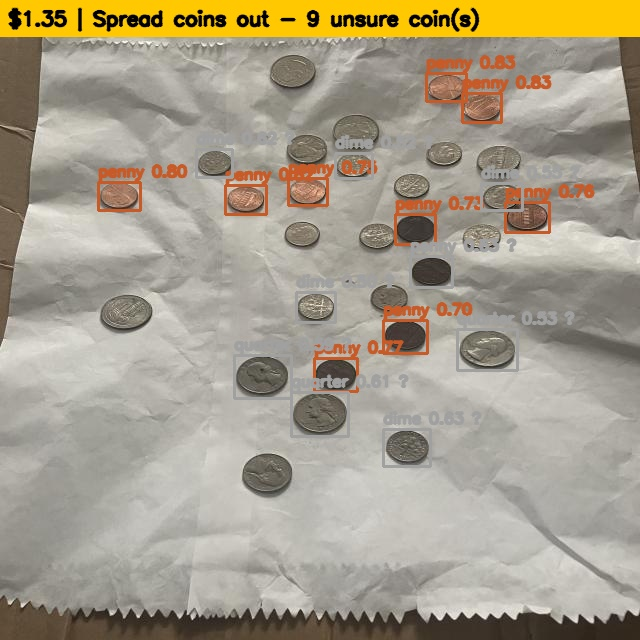
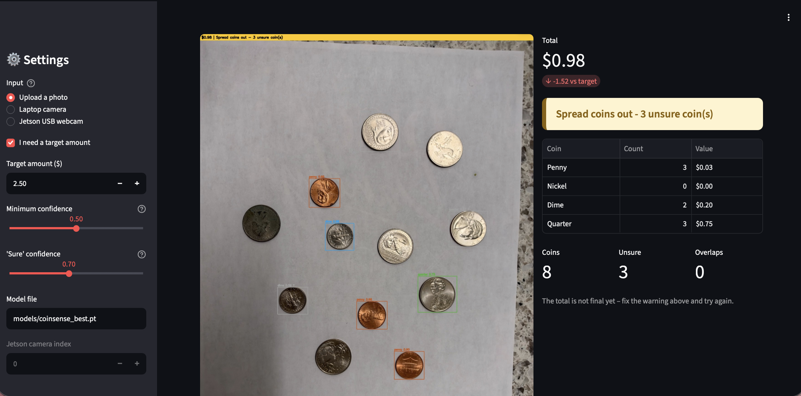

# CoinSense – Smart Coin Counter

CoinSense detects U.S. coins (penny, nickel, dime, quarter) on a table with a fine-tuned
**YOLOv8n** model running on an **NVIDIA Jetson**, counts them, adds up the total amount,
and makes decisions from the predictions.

This repository contains the **backend** (stage 2) and the **Streamlit frontend** (stage 3).

---

## Environment

| Item | Value |
|---|---|
| Hardware | NVIDIA Jetson (Orin), USB webcam |
| **Docker image** | **`nvcr.io/nvidia/l4t-ml:r36.2.0-py3`** |
| Container name | `jetson_labs_dev` |
| Python environment | conda env `yolo_gpu` (Python 3.10) |
| Model | YOLOv8n (Ultralytics), fine-tuned on a Roboflow U.S. coins dataset |
| Packages | see `requirements.txt` |

Start the environment on the Jetson:
```bash
docker start jetson_labs_dev
docker exec -it jetson_labs_dev bash
conda activate yolo_gpu
cd /home/jetson_labs/Coinsense
pip install roboflow pytest streamlit pandas      # the rest is already installed in yolo_gpu
pip install --force-reinstall --no-deps "numpy==1.26.4" "opencv-python==4.10.0.84"   # roboflow upgrades these; restore Jetson-compatible versions
```

---

## Project structure

```
coinsense/
├── app.py               # Streamlit frontend (web page)
├── backend/
│   ├── config.py        # coin values, roll sizes, thresholds, label aliases
│   ├── detector.py      # loads the YOLO model -> list of Detection objects
│   ├── decisions.py     # counting, total, decision rules, flicker smoothing
│   └── pipeline.py      # image -> detect -> decide -> draw results
├── scripts/
│   ├── download_dataset.py   # get the coin dataset from Roboflow
│   ├── train.py              # fine-tune YOLOv8n on the Jetson GPU
│   ├── run_image.py          # run the backend on one photo
│   ├── run_webcam.py         # run the backend live on the webcam
│   └── evaluate.py           # mAP/precision/recall + decision accuracy
├── tests/test_decisions.py   # tests for the decision rules
├── models/coinsense_best.pt  # trained model (fine-tuned YOLOv8n)
├── data/                     # dataset (not uploaded to GitHub)
├── outputs/                  # result image, training curves, confusion matrix
├── requirements.txt
└── README.md
```

---

## How the backend works

1. **Detect** – `CoinDetector` runs the fine-tuned YOLOv8n model on a frame. Labels from
   the dataset (e.g. `1c`, `Penny`, `quarters`) are mapped to `penny / nickel / dime / quarter`.
   Detections below **50 %** confidence are ignored.
2. **Count & total** – coins are counted per type and multiplied by their value
   (1¢, 5¢, 10¢, 25¢).
3. **Decide** – `make_decision()` applies the rules below.
4. **Smooth** – `TotalStabilizer` only marks the total as final after it stays the same
   for **1 second**, because detections flicker between video frames.
5. **Draw** – boxes and labels on each coin (grey + `?` for unsure coins) and a colored
   status bar with the total and message.

### Decision rules

| Rule | Condition | Output |
|---|---|---|
| No coins | nothing detected | grey – "No coins detected" (not $0.00) |
| **Rule 3 – check the count** | two boxes overlap (IoU > 0.15) or a coin has 50–70 % confidence | yellow – "Spread coins out", total not final |
| **Rule 1 – target amount** | total ≥ target | green – "You have enough!" |
| | total < target | red – "You need $X more" |
| **Rule 2 – roll ready** | 40 quarters / 50 dimes / 40 nickels / 50 pennies | "quarter roll ready (40/40)" |

All thresholds can be changed in `backend/config.py`.

---

## How to run

### 1. Get the dataset (Roboflow Universe)
Pick a U.S. coins dataset on https://universe.roboflow.com (search "us coins"),
click **Download Dataset → YOLOv8 → Show download code**, and copy the
workspace, project, version and API key from the snippet.
```bash
export ROBOFLOW_API_KEY=your_key
python scripts/download_dataset.py --workspace WORKSPACE --project PROJECT --version 1
```
Used in this project: `--workspace snap-inc-guvc3 --project us-coins-ruajo --version 1`.

If YOLO cannot find the images, fix the relative paths in `data/coins/data.yaml`:
```bash
sed -i 's#\.\./train/images#train/images#; s#\.\./valid/images#valid/images#; s#\.\./test/images#test/images#' data/coins/data.yaml
echo "path: $(pwd)/data/coins" >> data/coins/data.yaml
```

### 2. Train (fine-tune YOLOv8n on the Jetson GPU)
```bash
python scripts/train.py --data data/coins/data.yaml --epochs 30
```
The best model is saved to `models/coinsense_best.pt`.

### 3. Run on a photo
```bash
python scripts/run_image.py path/to/coins.jpg --target 2.50
```
Prints the decision as JSON and saves the annotated image to `outputs/`.

### 4. Run live on the webcam
```bash
python scripts/run_webcam.py --target 2.50
```
Prints total, status and FPS once per second. `Ctrl+C` to stop.

### 5. Evaluate
```bash
python scripts/evaluate.py --data data/coins/data.yaml        # mAP, precision, recall
python scripts/evaluate.py --piles data/my_piles.csv          # exact-total accuracy
```

### 6. Test the decision rules
```bash
python -m pytest tests
```

---

## Results (trained on the Jetson)

**Dataset:** Roboflow Universe `snap-inc-guvc3/us-coins-ruajo`, version 1
(130 images after augmentation, 640×640, classes: penny, nickel, dime, quarter).
**Training:** YOLOv8n, 30 epochs, batch 8, image size 640, Jetson GPU.

| Class | mAP@0.5 |
|---|---|
| **All** | **0.826** |
| Penny | 0.925 |
| Quarter | 0.948 |
| Dime | 0.893 |
| Nickel | 0.537 |

Overall mAP@0.5:0.95 = 0.674. Inference ≈ 59 ms per image on the Jetson.

### Example run
```bash
python scripts/run_image.py data/coins/test/images/<image>.jpg --target 1.00
```
```json
{
  "counts": {"penny": 10, "nickel": 0, "dime": 5, "quarter": 3},
  "total": "$1.35",
  "status": "SPREAD_OUT",
  "color": "yellow",
  "message": "Spread coins out - 9 unsure coin(s)",
  "unsure_count": 9,
  "is_final": false
}
```
Several coins were detected with only 50–70 % confidence, so Rule 3 held back the
final total and asked the user to spread the coins out.



Training curves: `outputs/training_results.png` · Confusion matrix: `outputs/confusion_matrix.png`

### Observations
- Pennies are detected most reliably (distinct copper color).
- Nickels are the weakest class and are often confused with quarters and dimes
  (similar silver color); the confusion matrix shows this.
- Some coins in busy scenes are missed. The dataset is small (50 original photos),
  so the next step is adding my own labeled webcam photos and training longer.

## Frontend (Streamlit web app)

`app.py` is a web page that runs on the Jetson and is opened from the laptop's browser.
It calls the backend (`CoinPipeline.process_frame`) for every photo.

```bash
streamlit run app.py --server.address 0.0.0.0 --server.port 8501
```
Open **http://192.168.55.1:8501** (USB cable) in the laptop's browser.

**Controls (sidebar)**
- **Input:** upload a photo, take a photo with the laptop camera, or capture a frame from the Jetson USB webcam
- **Target amount ($):** turns on Rule 1 ("You have enough!" / "You need $X more")
- **Minimum confidence** and **"Sure" confidence** sliders: change which detections are ignored or marked unsure (Rule 3)
- **Model file:** path to the trained weights (default `models/coinsense_best.pt`)

**What the page shows**
- the photo with a colored box and label on each coin (grey `?` = unsure)
- the **total in big text** and the difference from the target
- a colored **status banner** (green = enough / counted, red = need more, yellow = spread coins out, grey = no coins)
- a **count table** (count and value per coin type), number of coins / unsure coins / overlaps
- "roll ready" messages (Rule 2)
- **count history**: save results and download them as CSV
- the raw backend JSON (expandable)



## Example output format (`run_image.py`)
```json
{
  "counts": {"penny": 1, "nickel": 0, "dime": 1, "quarter": 1},
  "total": "$0.36",
  "status": "NEED_MORE",
  "color": "red",
  "message": "You need $2.14 more",
  "roll_ready": [],
  "is_final": true
}
```

## Next stage
Final presentation: live demo on the Jetson, evaluation results, and improving the model
with more training images (especially nickels).
